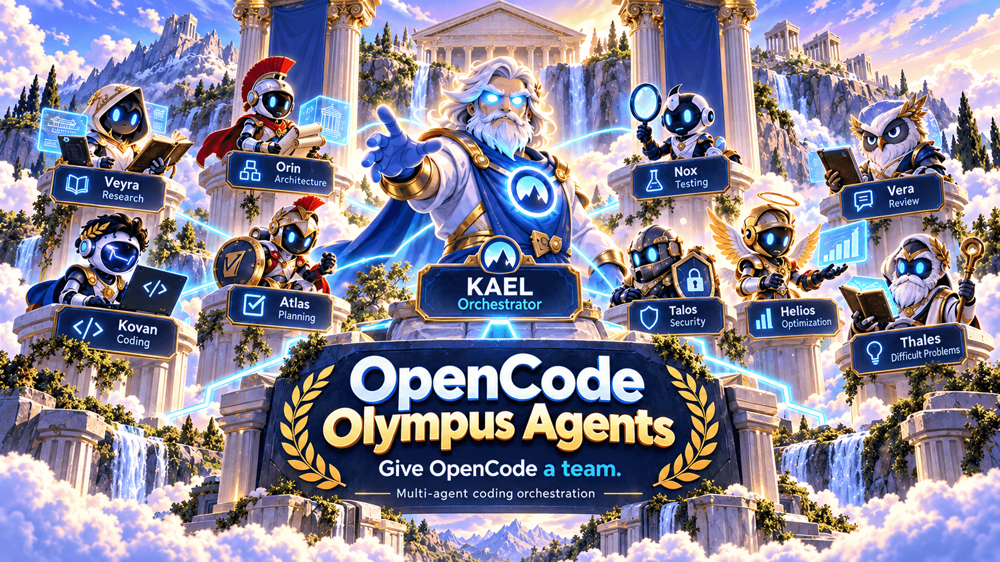

<div align="center">

# 🏛️ Olympus Agents



**Tu equipo de programación con IA. Una instrucción, once roles. Tú tienes el control.**

🌐 **[English](README.md) · Español**

[](https://github.com/Edulynch/OpenCode-OlympusAgents/releases/latest) [](docs/HARNESSES.md) [](LICENSE)

**[🎯 Pruébalo](#your-first-task) · [⚡ Instala](#fast-install) · [👥 Equipo](#the-team) · [🧭 Comandos](#task-parallelism) · [🛠️ CLI](#portable-cli) · [📚 Guías](#guides)**

</div>

<a id="your-first-task"></a>

## 🎯 Tu primera tarea

Después de [instalar Olympus](#fast-install), abre OpenCode en tu proyecto y dile a Kael qué quieres hacer:

> 📱 **Crea:** Haz una app en Flutter para registrar hábitos, con almacenamiento local y una primera pantalla sencilla.

> 🐛 **Corrige:** Averigua por qué falla esta API, corrige la causa y ejecuta las pruebas relevantes.

**🧭 Empieza con Kael.** Se encarga de sumar especialistas cuando aportan algo. No tienes que elegir un agente para cada paso.

¿Quieres trabajar en paralelo o evaluar el rendimiento? Consulta los [comandos de OpenCode](#task-parallelism).

<a id="fast-install"></a>

## ⚡ Instala o actualiza

### Windows

**Requisitos:** PowerShell 7 (`pwsh`), OpenCode V2 y Python 3.11+.

```powershell
& ([scriptblock]::Create((irm 'https://github.com/Edulynch/OpenCode-OlympusAgents/releases/latest/download/install-olympus.ps1')))
```

✅ **Después de instalar:** abre una nueva ventana de PowerShell 7 y ejecuta `olympus version`.

### Linux

**Requisitos:** `curl`, `sh`, OpenCode V2 y Python 3.11+.

Cuando la [última versión publicada](https://github.com/Edulynch/OpenCode-OlympusAgents/releases/latest) incluya `install-olympus.sh`, ejecuta:

```sh
curl -fsSL https://github.com/Edulynch/OpenCode-OlympusAgents/releases/latest/download/install-olympus.sh | sh
```

Validado en Ubuntu 24.04 con WSL 2. [Configuración y verificación en Linux (en inglés) →](docs/INSTALLATION.md#linux-sh-entrypoint)

🔄 **¿Ya lo tienes instalado?** Ejecuta `olympus update` y luego `olympus doctor --scope global`.

🛡️ **Alcance:** la instalación es **global para tu usuario y solo para OpenCode**. Selecciona una versión publicada e inmutable y configura a Kael como agente global predeterminado. [Detalles de instalación y seguridad (en inglés) →](docs/INSTALLATION.md)

## 📌 Instala una versión específica

**Windows:** instala la versión fijada `v0.12.1`:

```powershell
& ([scriptblock]::Create((irm 'https://raw.githubusercontent.com/Edulynch/OpenCode-OlympusAgents/v0.12.1/install.ps1')))
```

**Linux:** cuando la última versión incluya el instalador de Linux, sustituye `vX.Y.Z` por el tag de una versión estable que admita la instalación en Linux:

```sh
curl -fsSL https://github.com/Edulynch/OpenCode-OlympusAgents/releases/latest/download/install-olympus.sh | sh -s -- vX.Y.Z
```

<a id="the-team"></a>

## 👥 Conoce al equipo

| Agente | Cuándo te ayuda |
| --- | --- |
| 🧭 **Kael** | Coordina tu tarea y reúne los resultados. |
| 🔎 **Veyra** | Encuentra código, documentación y evidencia relevante. |
| 🏗️ **Orin** | Diseña interfaces y compara opciones de arquitectura. |
| 🗺️ **Atlas** | Convierte un cambio acordado en un plan paso a paso. |
| 💻 **Kovan** | Implementa cambios dentro del alcance acordado. |
| 🐛 **Argus** | Diagnostica errores cuando la causa no es evidente. |
| 🧪 **Nox** | Ejecuta pruebas y comprueba qué pasó realmente. |
| ⚖️ **Vera** | Revisa cambios de forma independiente para detectar errores y regresiones. |
| 🛡️ **Talos** | Diagnostica fallas de seguridad y evalúa su impacto. |
| 🧠 **Thales** | Ayuda a resolver fallas técnicas difíciles de explicar. |
| 🚀 **Helios** | Evalúa si una mejora de rendimiento justifica su costo y riesgo. |

🧠 **Modelos predeterminados:** los roles Sol usan GPT‑6.2 Sol. Los roles Luna y los modelos que elegiste explícitamente no cambian. [Configuración de modelos (en inglés) →](docs/INSTALLATION.md#olympus-cli)

<a id="task-parallelism"></a>

## 🧭 Comandos de OpenCode

⚡ **`/olympus.ultra <prompt>`** — ejecuta trabajo independiente hasta el límite configurado (de 1 a 8). Si solo hay dos tareas útiles, usa como máximo dos subagentes aunque haya seis espacios disponibles.

> `/olympus.ultra Revisa estos módulos independientes y resume las pruebas.`

📈 **`/olympus.performance <prompt>`** — parte de una medición inicial y propone una mejora. Kael te pide autorización antes de aplicarla, salvo que ya hayas aprobado ese cambio específico. Después compara los resultados y verifica que nada se haya roto.

> `/olympus.performance Evalúa cómo reducir el tiempo de respuesta de este endpoint sin cambiar su comportamiento.`

💬 **Los dos necesitan una instrucción.** No hay alias `/ultra` ni `/performance`. Si dejas los argumentos vacíos, el agente debe mostrar cómo usar el comando; OpenCode no lo impone desde su parser. [Detalles de uso (en inglés) →](docs/WORKFLOWS.md#native-task-commands)

<a id="portable-cli"></a>

## 🛠️ Olympus CLI

| Comando | Para qué sirve |
| --- | --- |
| `olympus --help` | Consulta los comandos más usados y sus ejemplos. |
| `olympus update` | Busca una versión estable más reciente. |
| `olympus agents list` | Consulta los modelos y el nivel de razonamiento de los agentes. |
| `olympus config set-max-parallel 6` | Guarda el límite global de subagentes directos activos por sesión principal. |
| `olympus doctor --scope global` | Revisa la instalación global sin modificarla. |

🔍 **¿Necesitas más detalles?** Prueba `olympus update --help` para ver la ayuda del comando o agrega `--verbose` para ver qué se ejecutó. Para automatizar, usa `--json` en los comandos que lo admiten. [Todos los comandos y opciones avanzadas (en inglés) →](docs/INSTALLATION.md#olympus-cli)

<a id="fast-uninstall"></a>

## 🗑️ Desinstala

```powershell
olympus uninstall
```

Elimina los recursos administrados por Olympus que no se hayan modificado y su entrada en el PATH de Windows. Conserva los archivos ajenos a Olympus y los cambios posteriores al agente predeterminado. [Detalles de desinstalación (en inglés) →](docs/INSTALLATION.md)

<a id="guides"></a>

## 📚 Guías

La documentación técnica está en inglés.

| Tema | Dónde encontrarlo |
| --- | --- |
| ⚡ **Instalación y desinstalación** | [Alcance, opciones y solución de problemas](docs/INSTALLATION.md) |
| 🎯 **Cómo usar Olympus** | [Comandos y ejemplos](docs/WORKFLOWS.md) |
| 🛠️ **CLI** | [Configuración y diagnósticos](docs/INSTALLATION.md#olympus-cli) |
| 🧩 **Soporte de OpenCode** | [Funciones compatibles y sus límites](docs/HARNESS-CAPABILITIES.md) |
| 🛡️ **Seguridad** | [Reporta un problema de seguridad](SECURITY.md) |
| 🧑‍💻 **Contribuye** | [Desarrollo](docs/DEVELOPMENT.md) · [Hoja de ruta](docs/ROADMAP.md) · [Árboles de trabajo](docs/WORKTREES.md) |
| 📦 **Versiones** | [Última versión estable](https://github.com/Edulynch/OpenCode-OlympusAgents/releases/latest) · [Todas las versiones](https://github.com/Edulynch/OpenCode-OlympusAgents/releases) · [Registro de cambios](CHANGELOG.md) |
| 📖 **Toda la documentación** | [Índice de guías](docs/README.md) · [Licencia](LICENSE) |

<sub>Olympus es un sistema de coordinación independiente, no un fork. La idea de un equipo especializado se inspiró en parte en [codex-astra-luna-orchestrator](https://github.com/donvito/codex-astra-luna-orchestrator) (Apache-2.0).</sub>

## ⚠️ Uso y responsabilidad

Los agentes pueden modificar archivos y ejecutar comandos según los permisos que les concedas. Empieza en una rama de prueba y revisa los cambios antes de integrarlos.

Olympus se proporciona «tal cual», sin garantías. Consulta la [licencia MIT](LICENSE) para conocer los términos completos, incluida la limitación de responsabilidad.
