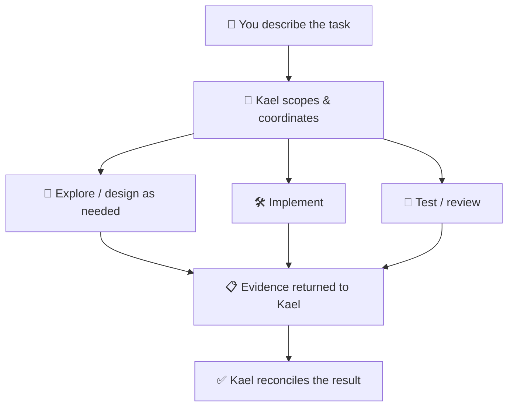

<div align="center">

# 🏛️ Olympus Agents


**An AI coding team built for OpenCode V2.**

*Describe the goal. Kael coordinates the specialists. You keep control.*

[](https://github.com/Edulynch/OpenCode-OlympusAgents/releases/latest) [](https://opencode.ai/docs/) [](docs/HARNESSES.md) [](LICENSE)

[⚡ Install](#fast-install) · [💬 Try it](#-start-building) · [🧭 Agents](#-meet-the-team) · [🖥️ CLI Mode](#-cli-mode--in-progress) · [🧹 Uninstall](#fast-uninstall)

</div>

**🚀 The idea:** install Olympus into a trusted project, open OpenCode, and tell Kael what to build. Agent roles, routing, and model choices come preconfigured by Olympus; you do **not** have to wire up twelve agents manually. You'll still need a working OpenCode installation and access to the configured models.

## Requirements

- 🪟 **Windows** — currently the qualified platform for the installer. Linux/macOS installation is not qualified.
- ⚡ **PowerShell 7** (`pwsh` on `PATH`). Windows PowerShell 5.1 alone is insufficient.
- 🌱 **Git** — for project installs, use the root of a trusted Git worktree.
- 🤖 **OpenCode V2**, with your OpenAI model access configured in the runtime.

## Fast Install

⚡ **One copy-paste command, no Olympus clone.** Pick your project/global scope and runtime when prompted; the OpenCode project install configures Kael as the project's default agent.

The URLs below start from the versioned `v0.4.10` bootstrap. That bootstrap queries GitHub's `releases/latest` metadata to select an eligible published release and tag; `v0.4.10` is not a preselected final installer version. The release metadata checks fail closed when their requirements are not met.

```powershell
irm https://raw.githubusercontent.com/Edulynch/OpenCode-OlympusAgents/v0.4.10/install-olympus.ps1 | iex
```

> **⚠️ Release acceptance:** the first public installation smoke for v0.4.10 failed on timestamp parsing. The fix and repeat smoke are tracked in [#66](https://github.com/Edulynch/OpenCode-OlympusAgents/issues/66); the command above is published, but a successful public install is **not yet verified**.

## 💬 Start Building

After a successful project install, open `opencode` in that project and tell Kael what you need. You can start small:

> **📱 Build:** "Create a simple Flutter habit tracker with local storage. Implement a usable first screen and add focused tests."

> **🐛 Fix:** "Investigate why my Spring Boot endpoint returns 409 for valid requests. Find the root cause, make the smallest safe fix, and validate it."

> **⚡ FAST:** "FAST: review these independent modules for bugs, fix verified issues, and report test results."

### ✨ Example: one request, a coordinated team



*Illustrative route, not a fixed pipeline. Kael calls only the roles a task needs, and reports limits rather than inventing successful runs.*

## 🧭 Meet the Team

Twelve specialized roles, **one orchestration point**. These are the current OpenCode model assignments, not a promise that every role runs in every session.

| Agent | What they do | Model | Reasoning |
|---|---|---|---|
| 🧭 **Kael** · The Master | Coordinates, delegates and reconciles outcomes | GPT-6.1 Sol | High |
| 🔎 **Veyra** · The Explorer | Explores code and gathers evidence | GPT-6 Luna | Max |
| 🏗️ **Orin** · The Architect | Designs architecture and boundaries | GPT-6 Luna | Max |
| 🗺️ **Atlas** · The Planner | Plans scoped implementation when needed | GPT-6.1 Sol | High |
| 🛠️ **Kovan** · The Coder | Implements approved changes | GPT-6 Luna | Max |
| 🐛 **Argus** · The Bug Hunter | Diagnoses nontrivial functional defects | GPT-6.1 Sol | High |
| 🧪 **Nox** · The Tester | Runs focused tests and gathers runtime evidence | GPT-6 Luna | Max |
| ⚖️ **Vera** · The Judge | Independently reviews evidence and changes | GPT-6 Luna | Max |
| 🛡️ **Talos** · The Sentinel | Investigates security and trust-boundary defects | GPT-6.1 Sol | High |
| 🧠 **Thales** · The Sage | Reasons through difficult, uncertain problems | GPT-6.1 Sol | XHigh |
| ☀️ **Helios** · The Optimizer | Evaluates optimizations when explicitly requested | GPT-6.1 Sol | High |
| 🔐 **Aegis** · The Keeper | Hidden privileged executor; only via explicit `/maintain` | GPT-6 Luna | Max |

🎯 **OpenAI-first by design.** Olympus has been developed primarily with OpenAI models because its maintainer does not have subscriptions to other AI providers. The default mappings use OpenAI Sol/Luna IDs; they do not imply other providers have been tested or that your OpenAI account automatically has access to every model. [Canonical model mapping](olympus/core/models.toml).

## ⚡ NORMAL vs FAST

**NORMAL (default):** Kael chooses only useful parallel work for the task.

**FAST (explicit):** Kael may use up to four independent agents, keeps required checks and does not parallelize dependent tasks.

## 🖥️ CLI Mode — In Progress

A separate, portable **Olympus CLI** is being developed and refined. It is **not** yet a replacement for the public one-command installer.

- ✅ **Slice A — shipped:** inspect roles/models, check source configuration, and read installation metadata.
- ✅ **Slice B — accepted:** preview and explicitly edit model mappings in a trusted source checkout, with rollback/recovery protections. Changes are **not** applied to installed runtimes.
- 🚧 **Slice C — blocked:** installed configuration apply and CLI-managed install/uninstall are **not** available yet.

For now, the CLI requires **Python 3.11+ and a trusted Olympus source checkout**; some editing operations need an optional dependency. The read-only commands include `python -B -m olympus models list` and `python -B -m olympus config check`. See the [CLI quickstart and limitations](specs/001-portable-olympus-cli/quickstart.md). macOS is not verified.

## Fast Uninstall

🧹 **One matching command.** The safe uninstaller removes eligible, unchanged Olympus-managed resources and protects unrelated user files.

```powershell
irm https://raw.githubusercontent.com/Edulynch/OpenCode-OlympusAgents/v0.4.10/uninstall-olympus.ps1 | iex
```

🛡️ The bootstrap selects a tag for its release launcher; that launcher resolves `releases/latest` again for the installer and source archive and checks installer identity before execution. GitHub's immutability flag is not independent cryptographic signature verification. See [installation, parameters, safety, and troubleshooting](docs/INSTALLATION.md).

## 🛡️ Trust & Compatibility

**OpenCode V2 is the active development target.** **Codex is preserved at a frozen compatibility baseline**—not removed or discarded, but not the focus of new features. Codex lacks equivalent Aegis and native hard-DENY guarantees; see the [capability matrix](docs/HARNESS-CAPABILITIES.md) and [Codex baseline](docs/CODEX-COMPATIBILITY.md).

Run Olympus only in trusted repositories: task scope is not an OS sandbox.

## 🔧 Maintenance (OpenCode)

Ordinary Git work, including releases, stays with Kael in the normal project workflow. Only an explicit `/maintain` invokes hidden Aegis; Kael never escalates there automatically. Codex has no equivalent Aegis capability.

## 📖 Explore More

[🚀 Installation & safety](docs/INSTALLATION.md) · [👀 Runtime capabilities](docs/HARNESS-CAPABILITIES.md) · [🧰 Development](docs/DEVELOPMENT.md) · [🗺️ Roadmap](docs/ROADMAP.md) · [🌱 Worktrees](docs/WORKTREES.md) · [📦 Releases](https://github.com/Edulynch/OpenCode-OlympusAgents/releases) · [📝 Changelog](CHANGELOG.md) · [📄 License](LICENSE)

<sub>Olympus is an independent orchestration system, not a fork. The specialized-team idea was informed in part by [codex-astra-luna-orchestrator](https://github.com/donvito/codex-astra-luna-orchestrator) (Apache-2.0).</sub>
