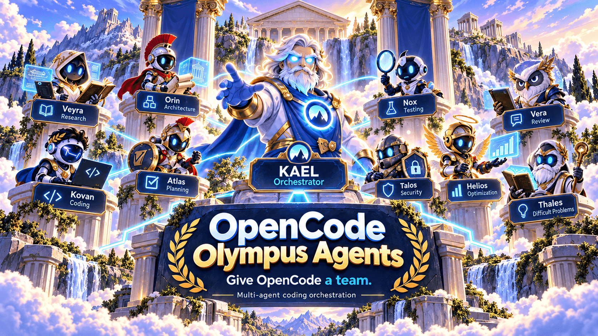
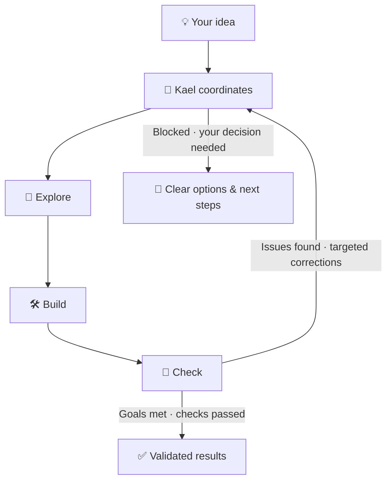

<div align="center">

# 🏛️ Olympus Agents



**Your AI development team, ready for OpenCode.**

*You bring the idea. Kael brings the team. You stay in control.*

[](https://github.com/Edulynch/OpenCode-OlympusAgents/releases/latest) [](https://opencode.ai/docs/) [](docs/HARNESSES.md) [](LICENSE)

[⚡ Install](#fast-install) · [🚦 Modes](#-normal-vs-fast) · [💬 Get started](#-your-first-task) · [🧭 Meet the team](#-meet-the-team) · [🖥️ CLI Mode](#-cli-mode) · [🧹 Uninstall](#fast-uninstall)

</div>

## ✨ Why Olympus?

Instead of juggling different AI helpers, work with **one coordinated team** right inside OpenCode.

- ✅ **Ready-to-use team:** agent roles and model choices are already set up.
- ✅ **The right specialist for each task:** explore, design, code, debug or review—without calling everyone every time.
- ✅ **Checks, not just code:** the team can test changes, review results and tell you what's still uncertain.
- ✅ **You stay in charge:** Olympus works within your project and keeps important decisions under your control.

Built mainly for **OpenAI models** because its maintainer uses OpenAI subscriptions rather than subscriptions to other AI providers. You still need your own OpenCode setup and access to the selected models; Olympus does not supply those subscriptions.

## Requirements

**Windows + PowerShell 7 + Git + OpenCode V2** with working OpenAI model access. For a project install, open PowerShell in the root of a Git project you trust. Other operating systems aren't yet qualified for this installer.

## Fast Install

**One command. No cloning Olympus. No manual agent-by-agent setup.**

Paste this in PowerShell. Olympus asks where to install and which app you're using; choose **this project** and **OpenCode** to get started.

```powershell
irm https://raw.githubusercontent.com/Edulynch/OpenCode-OlympusAgents/v0.4.10/install-olympus.ps1 | iex
```

[Installation options and safety details](docs/INSTALLATION.md)

## ⚡ NORMAL vs FAST

**NORMAL (default):** Kael chooses only the specialists your task needs and uses useful parallel work when it helps. Nothing extra to type.

**FAST (explicit):** Start your request with `FAST:` when it has independent parts. Kael can run up to four agents in parallel; FAST keeps required checks and does not parallelize dependent tasks.

## 💬 Your First Task

After installing in your project, open OpenCode and describe what you want in everyday language.

> 📱 **Build something:** "Create a simple Flutter habit tracker with local storage and a clean first screen."

> 🐛 **Fix a bug:** "Find why my API returns an error, fix the cause and check that existing behavior still works."

> ⚡ **Move faster:** "FAST: review these independent modules, fix confirmed problems and summarize the tests."

### 🪄 From idea to result



*OlympusAgents works as a coordinated team: it explores the problem, builds a solution, checks the result, and iterates with focused improvements when needed. It stops when the task is complete or when a blocker needs your attention.*

## 🧭 Meet the Team

Meet the twelve roles. **Kael is your main point of contact**—the others step in when their expertise is useful.

| Agent | Model / Reasoning | What they do |
|---|---|---|
| 🧭 **Kael** · The Master | GPT-6.1 Sol · High | Coordinates the team and results |
| 🔎 **Veyra** · The Explorer | GPT-6 Luna · Max | Finds the information the team needs |
| 🏗️ **Orin** · The Architect | GPT-6 Luna · Max | Designs the solution |
| 🗺️ **Atlas** · The Planner | GPT-6.1 Sol · High | Plans larger tasks when needed |
| 🛠️ **Kovan** · The Coder | GPT-6 Luna · Max | Writes and updates code |
| 🐛 **Argus** · The Bug Hunter | GPT-6.1 Sol · High | Tracks down tricky bugs |
| 🧪 **Nox** · The Tester | GPT-6 Luna · Max | Runs tests and checks behavior |
| ⚖️ **Vera** · The Judge | GPT-6 Luna · Max | Reviews work independently |
| 🛡️ **Talos** · The Sentinel | GPT-6.1 Sol · High | Investigates security issues |
| 🧠 **Thales** · The Sage | GPT-6.1 Sol · XHigh | Helps with especially difficult questions |
| ☀️ **Helios** · The Optimizer | GPT-6.1 Sol · High | Suggests improvements when asked |
| 🔐 **Aegis** · The Keeper | GPT-6 Luna · Max | Handles explicitly requested advanced maintenance |

*Model choices are included with Olympus, but availability depends on your OpenAI access. Aegis is an advanced, explicitly invoked role.*

## 🖥️ CLI Mode

We're also building a simpler way to explore and manage Olympus from the command line.

- ✅ See the team and its model choices.
- ✅ Check how your setup is configured.
- ✅ Preview and edit model choices in a trusted source copy.
- ⬜ Manage installed setups directly from the CLI — still in development.
- ⬜ One-command installation — final real-world checks are still underway.

The CLI tools for inspecting and editing settings are available from a source checkout; the everyday installer above remains the main way to get started. [Explore CLI development](specs/001-portable-olympus-cli/quickstart.md).

## Fast Uninstall

Changed your mind? Olympus includes a matching removal command designed to protect files you created yourself.

```powershell
irm https://raw.githubusercontent.com/Edulynch/OpenCode-OlympusAgents/v0.4.10/uninstall-olympus.ps1 | iex
```

[Removal options and safety details](docs/INSTALLATION.md)

## 🌱 What's next?

**OpenCode V2** is where new Olympus features are developed. **Codex hasn't been dropped**: existing compatibility is kept, but new Codex features are on hold for now. [See supported features](docs/HARNESS-CAPABILITIES.md).

## 📚 Learn More

[Installation guide](docs/INSTALLATION.md) · [CLI Mode](specs/001-portable-olympus-cli/quickstart.md) · [Roadmap](docs/ROADMAP.md) · [Development](docs/DEVELOPMENT.md) · [Releases](https://github.com/Edulynch/OpenCode-OlympusAgents/releases) · [License](LICENSE)
