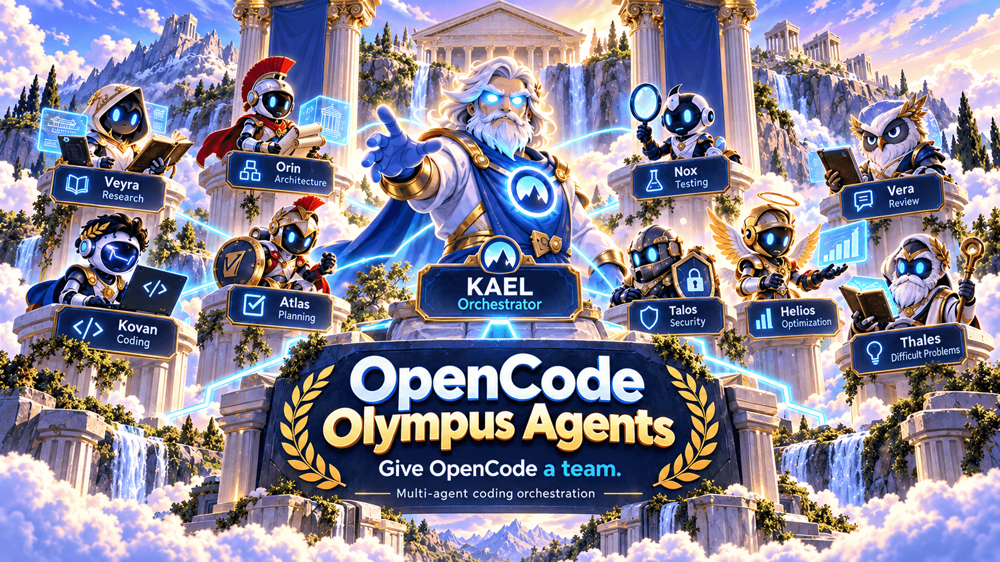

<div align="center">

# 🏛️ Olympus Agents



**Your AI coding team. One prompt. Nine roles. You stay in control.**

🌐 **English · [Español](README.ES.md)**

[](https://github.com/Edulynch/OpenCode-OlympusAgents/releases/latest) [](docs/HARNESSES.md) [](docs/INSTALLATION.md#linux-sh-entrypoint) [](https://github.com/anomalyco/opencode/releases/tag/v2.4.1) [](LICENSE)

**[🎯 Try it](#your-first-task) · [⚡ Install](#fast-install) · [🧩 Team](#the-team) · [🧭 Commands](#task-parallelism) · [🛠️ CLI](#portable-cli) · [📚 Guides](#guides)**

</div>

<a id="your-first-task"></a>

## 🎯 Your First Task

After [installing Olympus](#fast-install), open OpenCode in your project and tell Kael what you want to do:

> 📱 **Build:** Create a Flutter habit tracker with local storage and a simple first screen.

> 🐛 **Fix:** Find why this API fails, fix the cause, and run the relevant tests.

**🧭 Start with Kael.** It brings in specialists when they help. You don't have to pick an agent for each step.

Kael carries applicable validation evidence forward across implementation, pull requests, CI, and release handoffs, so checks need not be repeated just because the stage changed. If an acceptance criterion is still unsupported, it asks for the smallest needed check; required reviews and release gates still apply.

Need parallel work or a performance review? See [OpenCode commands](#task-parallelism).

## Fast Install

### Windows

**Requirements:** PowerShell 7 (`pwsh`), OpenCode V2, and Python 3.11+.

```powershell
& ([scriptblock]::Create((irm 'https://github.com/Edulynch/OpenCode-OlympusAgents/releases/latest/download/install-olympus.ps1')))
```

✅ **After installing:** open a new PowerShell 7 window and run `olympus version`.

### Linux

**Requirements:** `curl`, `sh`, OpenCode V2, and Python 3.11+.

The [latest stable release](https://github.com/Edulynch/OpenCode-OlympusAgents/releases/latest) includes the Linux entrypoint:

```sh
curl -fsSL https://github.com/Edulynch/OpenCode-OlympusAgents/releases/latest/download/install-olympus.sh | sh
```

Validated on Ubuntu 24.04 with WSL 2. [Linux setup and verification →](docs/INSTALLATION.md#linux-sh-entrypoint)

🔄 **Already installed?** Run `olympus update`, then `olympus doctor --scope global`.

🛡️ **Scope:** installation is **global and OpenCode-only** for your user. It selects a published, immutable release and sets Kael as the global default. [Installation safeguards →](docs/INSTALLATION.md)

## Install a specific version

Choose a published stable tag and replace `vX.Y.Z` with that exact tag.

**Windows:**

```powershell
& ([scriptblock]::Create((irm 'https://raw.githubusercontent.com/Edulynch/OpenCode-OlympusAgents/vX.Y.Z/install.ps1')))
```

**Linux:** use the same selected stable tag when it supports Linux installation:

```sh
curl -fsSL https://github.com/Edulynch/OpenCode-OlympusAgents/releases/latest/download/install-olympus.sh | sh -s -- vX.Y.Z
```

<a id="the-team"></a>

## 🧩 Meet the team

| Primary | Responsibility |
| --- | --- |
| 🧭 **Kael** | Owns task decisions, execution routing, evidence reconciliation, acceptance, and completion. It does not inspect repositories, research, run shell/Git/tests, or edit files. |
| 🗺️ **Atlas** | The separate read-only analysis and planning primary. It returns a scoped handoff to Kael; it does not execute or accept work. |

**Kael's seven specialists**

| Agent | When it helps |
| --- | --- |
| 🔎 **Veyra** | Finds relevant code, documentation, and evidence. |
| 💻 **Kovan** | Implements scoped changes and performs normal authorized project Git work. |
| 🧪 **Nox** | Reproduces issues, runs distinct checks, and measures results. |
| ⚖️ **Vera** | Independently reviews a supplied candidate when review is needed. |
| 🛡️ **Talos** | Diagnoses established security-boundary defects and assesses impact. |
| 🧠 **Thales** | Helps untangle difficult technical failures when bounded evidence remains uncertain. |
| 🚀 **Helios** | Evaluates explicit optimization requests using the performance method. |

Atlas is not a Kael child. Orin and Argus are retired and are not in the current nine-role roster.

🧠 **Default models:** Sol roles use GPT‑6.2 Sol. Luna roles and your explicit model choices are unchanged. [Model configuration →](docs/INSTALLATION.md#olympus-cli)

<a id="task-parallelism"></a>

## 🧭 OpenCode Commands

⚡ **`/olympus.ultra <prompt>`** — seeks ready, independent work up to the prompt-level ceiling (1–8) for the current Kael or Atlas session. The ceiling is not a target; no scheduler is added.

> `/olympus.ultra Review these independent modules and summarize the checks.`

📈 **`/olympus.performance <prompt>`** — explicit optimization intent. Uses Helios's method when useful, and requires approval of an unsettled concrete direction before implementation. Validation compares before/after/delta/target and checks correctness.

> `/olympus.performance Evaluate how to reduce this endpoint's latency without changing its behavior.`

🚀 **`/olympus.performance-ultra <prompt>`** — combines explicit optimization intent with Ultra admission; it does not authorize implementation or bypass either gate.

💬 **All three commands run from a Kael or Atlas primary and need a prompt.** Empty/whitespace arguments or an unsupported primary return usage or primary guidance without tools or agents. There are no bare aliases. [Workflow details →](docs/WORKFLOWS.md#native-task-commands)

<a id="portable-cli"></a>

## 🛠️ Olympus CLI

| Command | What it does |
| --- | --- |
| `olympus --help` | See common commands and examples. |
| `olympus update` | Check for a newer stable release. |
| `olympus agents list` | See agent models and reasoning settings. |
| `olympus config set-max-parallel 6` | Save the shared 1–8 prompt ceiling for Kael or Atlas direct children per root session. |
| `olympus doctor --scope global` | Check the global installation without changing it. |

🔍 **Need detail?** Try `olympus update --help` for command help or add `--verbose` to see what ran. Use `--json` where supported for scripts. [All CLI commands and advanced options →](docs/INSTALLATION.md#olympus-cli)

## Fast Uninstall

```powershell
olympus uninstall
```

🗑️ Removes unchanged Olympus-managed resources and its Windows PATH entry while preserving unrelated files and later default-agent choices. [Removal details →](docs/INSTALLATION.md)

<a id="guides"></a>

## 📚 Guides

| | Start here |
| --- | --- |
| ⚡ **Install / remove** | [Scopes, direct parameters and troubleshooting](docs/INSTALLATION.md) |
| 🎯 **Use Olympus** | [Team, task commands and prompt examples](docs/WORKFLOWS.md) |
| 🛠️ **CLI** | [Commands, model configuration, and diagnostics](docs/INSTALLATION.md#olympus-cli) |
| 🧩 **OpenCode support** | [Current capability contract](docs/HARNESS-CAPABILITIES.md) · [Installation and safety](docs/INSTALLATION.md) |
| 🛡️ **Security** | [Report a security issue](SECURITY.md) |
| 🧑‍💻 **Contribute** | [Development](docs/DEVELOPMENT.md) · [Roadmap](docs/ROADMAP.md) · [Worktrees](docs/WORKTREES.md) |
| 📦 **Releases** | [Latest stable release](https://github.com/Edulynch/OpenCode-OlympusAgents/releases/latest) · [All releases](https://github.com/Edulynch/OpenCode-OlympusAgents/releases) · [Changelog](CHANGELOG.md) |
| 📖 **All docs** | [Documentation index](docs/README.md) · [License](LICENSE) |

## 🔗 Mentions

- [XERJ Corpus Hub](https://hub.xerj.org/corpus/edulynch--opencode-olympusagents) — a catalog of open-source projects that gives AI tools more context.

## ⚖️ Use and responsibility

Agents can modify files and run commands depending on the permissions you grant. Start on a test branch, check that the permissions fit the task, and review suggested changes before applying or merging them. Run relevant checks and confirm the results before relying on them.

Olympus is provided “as is”, without warranty. See the [MIT License](LICENSE) for the full terms, including the limitation of liability.
