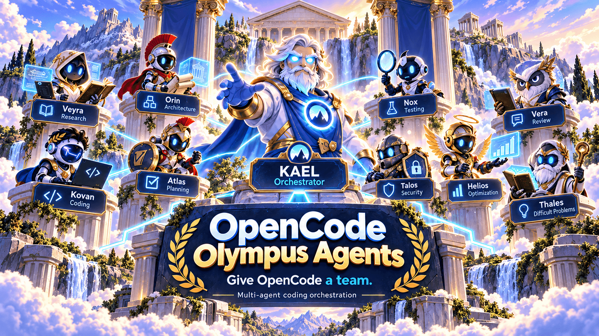

<div align="center">

# 🏛️ Olympus Agents



**Your AI coding team. One prompt. Eleven roles. You stay in control.**

*Tell Kael what you want to build. Olympus brings in the right specialists.*

[](https://github.com/Edulynch/OpenCode-OlympusAgents/releases/latest) [](docs/HARNESSES.md) [](LICENSE)

**[⚡ Install](#fast-install) · [🎯 Try it](#your-first-task) · [🧭 Workflows](#normal-vs-fast) · [🛠️ CLI](#portable-cli) · [🗑️ Uninstall](#fast-uninstall) · [📚 Guides](#guides)**

</div>

<a id="your-first-task"></a>

## 🎯 Your First Task

After installation, open OpenCode in your project and try a prompt:

> 📱 **Build:** Create a Flutter habit tracker with local storage and a simple first screen.

> 🐛 **Fix:** Find why this API fails, fix the cause, and run the relevant tests.

> ⚡ **FAST:** Review these independent modules, fix confirmed bugs, and summarize the checks.

**🧭 Kael coordinates.** Ten specialists help with discovery, architecture, coding, testing, review, and security. [Meet the team →](docs/WORKFLOWS.md#the-team)

## Requirements

🪟 **Windows** · **PowerShell 7 (`pwsh`)** · **OpenCode V2 and/or Codex CLI** · **Git** for project installation.

## Fast Install

⚡ **One release, one version: Olympus v0.6.1.** The public entrypoint and installer use the same immutable release tag. No checkout is required. PowerShell asks **where** (current project, another project, global) and **which harness** (OpenCode, Codex, both). Every successful project or global install also sets up the per-user `olympus` command and adds only its `bin` folder to your user PATH.

```powershell
& ([scriptblock]::Create((irm 'https://raw.githubusercontent.com/Edulynch/OpenCode-OlympusAgents/v0.6.1/install-olympus.ps1')))
```

Open a new PowerShell 7 window, then use `olympus version` and `olympus update` to see and maintain the installed product version. [Installation and safety details →](docs/INSTALLATION.md).

<a id="normal-vs-fast"></a>

## 🧭 NORMAL vs FAST

**NORMAL (default):** Kael uses parallel work only when useful for the task.

**FAST (explicit):** Up to four agents; keeps required checks and does not parallelize dependent tasks.

**Optional OpenCode task modifiers:** `long-mode` · `fast-mode` · `surgical-mode` are task-scoped prompt markers, not a parser or a runtime guarantee. [Examples and rules →](docs/WORKFLOWS.md#optional-opencode-task-modifiers)

<a id="portable-cli"></a>

## 🛠️ Olympus CLI

From any directory in a new PowerShell 7 window:

```text
olympus version
olympus update
olympus agents list
olympus nox set-model openai/gpt-6-luna
olympus nox set-effort high
olympus config list
olympus doctor
```

Model IDs use the exact `provider/model-id` form from [Models.dev](https://models.dev). Effective values use project overrides, then global overrides, then canonical defaults. Olympus validates known catalog-declared capabilities offline; a model absent from its bundled snapshot produces a compatibility warning, not an access check or rejection. It never checks credentials, subscriptions, or model access. Doctor is read-only; use `olympus install` for global JSON edits or `olympus update --scope project --target <worktree>` for project edits to apply them. `config list` prints absolute source paths. [Installation and safety →](docs/INSTALLATION.md)

## Fast Uninstall

🗑️ **Use `olympus uninstall`** to remove the global OpenCode installation and CLI, or choose a scope and harness in the entrypoint below. Uninstall removes only intact managed files and the Olympus PATH entry; user configuration and unrelated files are preserved.

```powershell
& ([scriptblock]::Create((irm 'https://raw.githubusercontent.com/Edulynch/OpenCode-OlympusAgents/v0.6.1/uninstall-olympus.ps1')))
```

<a id="guides"></a>

## 📚 Guides

| | Start here |
| --- | --- |
| ⚡ **Install / remove** | [Scopes, direct parameters and troubleshooting](docs/INSTALLATION.md) |
| 🎯 **Use Olympus** | [Team, NORMAL/FAST, prompt examples and task modifiers](docs/WORKFLOWS.md) |
| 🛠️ **CLI** | [Commands, model configuration, and diagnostics](docs/INSTALLATION.md#olympus-cli) |
| 🧩 **Compatibility** | [Harness capabilities](docs/HARNESS-CAPABILITIES.md) · [Codex limitations](docs/CODEX-COMPATIBILITY.md) |
| 🧑‍💻 **Contribute** | [Development](docs/DEVELOPMENT.md) · [Roadmap](docs/ROADMAP.md) · [Worktrees](docs/WORKTREES.md) |
| 📦 **Releases** | [Latest stable release](https://github.com/Edulynch/OpenCode-OlympusAgents/releases/latest) · [All releases](https://github.com/Edulynch/OpenCode-OlympusAgents/releases) · [Changelog](CHANGELOG.md) |
| 📖 **All docs** | [Documentation index](docs/README.md) · [License](LICENSE) |

**🚦 Support:** OpenCode V2 is in **ACTIVE DEVELOPMENT**; Codex is in **FROZEN COMPATIBILITY**. Windows is the qualified installer platform; other native installers and complete runtime parity are not claimed. [Details →](docs/HARNESSES.md)

<sub>Olympus is an independent orchestration system, not a fork. The specialized-team idea was informed in part by [codex-astra-luna-orchestrator](https://github.com/donvito/codex-astra-luna-orchestrator) (Apache-2.0).</sub>
